# Legal AI Answer Evaluation (V5)

This repository holds the evaluation system behind the master's thesis
**Hybrid Legal AI for Verifiable Legal Answers** by Emil Kanneworff
(MSc in Business Administration and Digital Business, Copenhagen Business
School, 2026). Chapter 6 of the thesis reports the evaluation, and Appendices C,
D and E describe this repository, the review tool and the agreement measures.

It is the final V5 version only. It contains the review tool, the 14 test
questions, the rubrics, the prompts, the five final answer runs, all labels from
the legal reviewer and the LLM judge, the result tables and the tests. Earlier
versions (V1 to V4), archived runs and test runs made after the evaluation are
not included.

> **Confidential.** This repository is private. It is shared only with the
> supervisor and the external examiner for the assessment of the thesis.
> Please do not copy, publish or redistribute it. See
> [Data confidentiality](#data-confidentiality).

## What the system does

The system tests how well legal AI answers questions about the Danish
SU-handicaptillæg (a disability supplement to the state education grant). A
legal reviewer and an LLM judge assess every answer on the same ten criteria,
and the two assessments are then compared.

- **14 questions.** XHAILe provided 34 determinations from the guidance on
  SU-handicaptillæg (VEJ nr. 9577 af 25/06/2025). The 14 questions cover 32 of
  them. A11 and A43 are left out because their labels do not match the
  guidance text. Every question is checked against the current guidance
  (VEJ nr. 10157 af 05/10/2026).
- **Expected answers.** Each question has an expected answer with critical
  elements, accepted variants and required qualifications. They were written
  with the legal reviewer, Patrick Michel, who approved the rubrics on
  1 November 2026. The wording of the questions was sharpened with him on
  5 November 2026, before the final answers were produced.
- **Three conditions.** Each question was answered without source, with the
  correct source and by my own RAG system, which finds the source itself.
- **Five runs and 70 answers.** GPT-6-luna and Llama 3.3 70B Instruct (Q8_0,
  run on UCloud) answered without source and with the correct source. My own
  RAG system (answer model GPT-6-luna) answered in the third condition. Each
  run has 14 answers.
- **Ten criteria.** Every answer gets Met, Not met or Not assessable on ten
  criteria, C01 to C10. They cover legal correctness, completeness, relevance,
  the three source criteria, unsupported additions, qualifications, reasoning
  and legal modality. No total score is calculated. An answer is **correct and
  complete** when C01 and C02 are both Met.
- **Legal reviewer.** Patrick Michel assessed all 70 answers himself in five
  rounds of 14. That is 700 decisions, and they form the human reference.
- **LLM judge.** Claude Sonnet 5.5 (`claude-sonnet-5-5`) assessed the same 70
  answers on the same criteria without seeing the legal reviewer's labels. It
  ran three times, so its stability can be measured. That is 2,100 decisions.

The full rules are in
[`Evaluation/docs/EVALUATION_PROTOCOL_V5.md`](Evaluation/docs/EVALUATION_PROTOCOL_V5.md)
and
[`Evaluation/scoring/TEN_CRITERIA_JUDGE_RUBRIC_V5.md`](Evaluation/scoring/TEN_CRITERIA_JUDGE_RUBRIC_V5.md).

## Terms in the thesis and in the files

The review tool and the data files were finished before the final wording of
the thesis, so a few names differ. The answers, the labels and the review tool
are kept as they were when the results were produced, and the screenshots in
Appendix D show the tool with these names.

| In the thesis | In the tool and the files |
|---|---|
| Without source | Question only, `closed_book` |
| With correct source | Correct source supplied, Question + correct source, `gold_context` |
| My own RAG system | Own RAG system, Self-retrieval (RAG), `self_retrieval` |
| Correct and complete (C01 and C02 Met) | Legally adequate (C1 and C2 met) |
| C01 to C10 | C1 to C10, `c01_...` to `c10_...` |
| Legal reviewer | Human reference, `reviewer = human` |

## About the files

- **Only the final version.** Some documents, such as the protocol, still
  mention files from earlier versions (V1 to V4) or records kept outside this
  repository, such as the legal reviewer's review workbook. These references
  are historical, and the files are not needed to check the results.
- **What was updated afterwards.** The answers, the labels, the raw judge
  replies and their timestamps are unchanged. After the evaluation, this README,
  the results README, the screenshots, the export script and some notes in the
  documentation and in `human_label_provenance.csv` were updated to the final
  file names and wording, and `check_thesis_numbers.py` was added.
- **Judge prompts.** The judge prompt
  (`Evaluation/prompts/llm_judge_prompt_v3_c04_reviewer_wording.txt`) and the
  criteria file (`Evaluation/scoring/TEN_CRITERIA_JUDGE_RUBRIC_V5_C04_ALIGNED.md`)
  are part of every judge prompt. In both, C04 is worded exactly as in the legal
  reviewer's review tool. They are kept exactly as the judge received them on
  15 November 2026, so `prompt_hash` in `ai_review_c04_aligned.csv` can be
  recomputed for all 210 assessments. `TEN_CRITERIA_JUDGE_RUBRIC_V5.md` is the
  general record of the ten criteria.
- **Records.** Each judge assessment records when it was made (`judged_at`)
  and how many attempts it took (`attempts`). How each block of the legal
  reviewer's labels was recorded is described in `human_label_provenance.csv`.

## Check the numbers in the thesis

One script recomputes the numbers that the thesis reports, directly from the
saved label files, and checks the fingerprints of the five answer runs. It only
needs Python 3.

```bash
python3 Evaluation/scripts/check_thesis_numbers.py
```

It checks Table 6.2, Figures 6.4 and 8.1, the agreement numbers in Chapters 6
and 9 and Appendix E, the 700 decisions, the three source labels that changed
once the source rule was clear and the SHA-256 fingerprints described in
Section 6.3. Each line prints OK or MISMATCH with the place in the thesis, and
the last line reads "All numbers match the thesis."

## Repository layout

```text
Hybrid-Legal-AI-for-Verifiable-Legal-Answers/
├── README.md
├── requirements.txt              points to Evaluation/requirements.txt
├── docs/images/                  the screenshots from Appendix D
├── results/                      results workbook (Excel)
└── Evaluation/
    ├── review.py                 the review tool (Streamlit app)
    ├── requirements.txt          pinned Python packages
    ├── .streamlit/config.toml    runs the app on 127.0.0.1 only
    ├── benchmark/                questions, expected answers, XHAILe determinations, sources
    ├── prompts/                  answer prompts and the LLM judge prompt
    ├── scoring/                  the ten-criteria rubric and the version the judge received
    ├── docs/                     protocol and provenance records
    ├── scripts/                  code used by the tool, the results export and the number check
    ├── outputs/
    │   ├── final_v5/             the five answer runs (outputs.jsonl and run_metadata.json)
    │   ├── v5_review/            the legal reviewer's labels and result tables
    │   └── v5_judge_c04_aligned/ the LLM judge's labels, raw judge replies and agreement tables
    └── tests/                    unit tests
```

The most important files

| File | Content |
|---|---|
| `Evaluation/benchmark/testcases_su_guidance_qa_v5.jsonl` | The 14 questions with source passages and hidden reference data |
| `Evaluation/benchmark/expert_answer_criteria_su_guidance_qa_v5.csv` | The approved expected answers and question rubrics |
| `Evaluation/benchmark/gold_determinations_su_v1.jsonl` | The 34 XHAILe determinations |
| `Evaluation/benchmark/legal_authorities_su_v1.json` | The current legal sources given to the judge |
| `Evaluation/benchmark/sources/raw/` | Frozen copies of the official guidance and law from Retsinformation |
| `Evaluation/docs/GUIDANCE_VERSION_CHECK_2026-11-16.md` | Word comparison of the guidance used in the evaluation (VEJ nr. 10157) with the version that replaced it (VEJ nr. 10278), with both texts in `Evaluation/benchmark/sources/version_check/` |
| `Evaluation/prompts/plain_question_v1.txt` | Answer prompt without source and for my own RAG system |
| `Evaluation/prompts/plain_source_question_v1.txt` | Answer prompt with the correct source |
| `Evaluation/prompts/llm_judge_prompt_v3_c04_reviewer_wording.txt` | The LLM judge prompt |
| `Evaluation/scoring/TEN_CRITERIA_JUDGE_RUBRIC_V5_C04_ALIGNED.md` | The criteria file the LLM judge received, with C04 worded as in the review tool |
| `Evaluation/outputs/final_v5/*/run_metadata.json` | Run settings and SHA-256 fingerprints of questions, prompt, code and answers |
| `Evaluation/outputs/v5_review/simple_reviews.csv` | The legal reviewer's 70 assessments (700 labels with reasons) |
| `Evaluation/outputs/v5_judge_c04_aligned/ai_review_c04_aligned.csv` | The 210 LLM judge assessments (three runs) |
| `Evaluation/outputs/v5_judge_c04_aligned/raw/` | The raw judge reply for every assessment |
| `Evaluation/outputs/v5_review/human_label_provenance.csv` | How each block of the legal reviewer's labels was entered |
| `Evaluation/outputs/v5_review/simple_reviews_before_source_rule_2026-11-05.csv` | The legal reviewer's first labels for the blocks without source, from before the source rule was clear to him. Three source labels changed afterwards |
`Evaluation/benchmark/judge_subset_su_guidance_v5.csv` records an earlier
ten-question selection. It is kept because a test and the template script use
it. The final evaluation uses all 14 questions.

## Run the review tool

The tool was built and tested with Python 3.11 on macOS.

```bash
python3 -m venv .venv
.venv/bin/pip install -r requirements.txt
cd Evaluation
../.venv/bin/streamlit run review.py --server.port 8502
```

Then open http://127.0.0.1:8502 in a browser.

The tool opens with all 70 answers assessed and all three judge runs done.
The pages are

- **Assess** shows each answer next to the correct source and the expected
  answer, with the saved labels. The labels are locked because the judge has
  seen them.
- **LLM judge** shows the three judge runs.
- **Results** shows the tables for each model and condition, the agreement
  between the legal reviewer and the judge, and the judge's stability.
- **About the questions** shows the 14 questions and the 34 XHAILe
  determinations.
- **Paste RAG answers** was used to enter the answers from my own RAG system
  by hand.

No API key is needed to read the data. A key is only needed to generate new
answers or to start new judge runs, and that would add new data to the
repository. The tool keeps API keys in the macOS Keychain. No key is stored in
any file in this repository.

Opening the Results page rewrites the CSV tables in
`Evaluation/outputs/v5_review/results/` from the saved labels. The content stays
the same, and the number check above confirms it.

## Run the tests

Run the tests from the repository root.

```bash
.venv/bin/python -m unittest discover -s Evaluation/tests -t .
```

There are 44 tests in six modules. They cover the run settings and answer
prompts, the manual entry of RAG answers, the review logic and result tables,
the LLM judge pipeline, the agreement calculation and the import of the legal
reviewer's labels from Excel. The tests use temporary folders and a fake judge.
They do not call any API.

## Where the results are

| File | Content | In the thesis |
|---|---|---|
| [`Evaluation/outputs/v5_review/results/table2_summary.csv`](Evaluation/outputs/v5_review/results/table2_summary.csv) | Met, Not met and Not assessable per criterion for all five runs | Table 6.2, Figure 6.4 |
| [`Evaluation/outputs/v5_judge_c04_aligned/results/judge_agreement_subsets.csv`](Evaluation/outputs/v5_judge_c04_aligned/results/judge_agreement_subsets.csv) | Agreement, Cohen's kappa, stability and direction for the 56 answers and for my own RAG system | Figure 6.5, Appendix E |
| [`Evaluation/outputs/v5_review/results/table1_answers.csv`](Evaluation/outputs/v5_review/results/table1_answers.csv) | Every answer with its ten labels from the legal reviewer | Figure 6.2 (question 13), Figure 8.1 |
| [`Evaluation/outputs/v5_judge_c04_aligned/results/table3_agreement.csv`](Evaluation/outputs/v5_judge_c04_aligned/results/table3_agreement.csv) | Legal reviewer against judge run 1, all 70 answers, with Cohen's kappa | Appendix D (the Results page) |
| [`Evaluation/outputs/v5_judge_c04_aligned/results/table4_stability.csv`](Evaluation/outputs/v5_judge_c04_aligned/results/table4_stability.csv) | How often the judge gave the same label in all three runs, all 70 answers | Appendix D (the Results page) |
| [`Evaluation/outputs/v5_review/results/all_reviews.csv`](Evaluation/outputs/v5_review/results/all_reviews.csv) | All labels and reasons from the legal reviewer in one table | Chapter 6 |
| [`Evaluation/outputs/v5_review/results/questions_14.csv`](Evaluation/outputs/v5_review/results/questions_14.csv) and [`xhaile_points_34.csv`](Evaluation/outputs/v5_review/results/xhaile_points_34.csv) | The questions and the XHAILe determinations as tables | Appendix D |
| [`results/SU_evaluation_results_2026-11-15.xlsx`](results/SU_evaluation_results_2026-11-15.xlsx) | Results workbook with 12 sheets for the 56 answers without source and with correct source. The sheet "Read me" explains the rest | Background for Chapter 6 |

The tool counts agreement for all 70 answers, while Chapter 6 and Appendix E
use the 56 answers without source and with correct source, so those numbers
differ.
[`Evaluation/outputs/v5_review/results/README.md`](Evaluation/outputs/v5_review/results/README.md)
sums up the main numbers.

Counted from `simple_reviews.csv`, 1 of 28 answers was correct and complete
without source, 18 of 28 with the correct source and 4 of 14 from my own RAG
system.

A new workbook with all five runs can be built from the saved labels.

```bash
cd Evaluation
../.venv/bin/python -m scripts.export_results_workbook ../results/SU_evaluation_results_all_runs.xlsx
```

## Data confidentiality

This repository is private and must not be shared further.

- It contains XHAILe's unpublished determinations (34 records received from
  the research project).
- It contains the legal reviewer's approved expected answers and his 700
  labels with reasons.
- It contains the full model answers and the raw judge replies.

The official guidance and law in `Evaluation/benchmark/sources/raw/` are
public copies from Retsinformation.

The evaluation of 5 November 2026 used VEJ nr. 10157 af 05/10/2026, which was
in force on that day. It has since been replaced by VEJ nr. 10278 of the same
date. `Evaluation/docs/GUIDANCE_VERSION_CHECK_2026-11-16.md` lists the 12
differences, which are editorial.

Please use the material only to assess the thesis, and do not upload it to
other services.

The repository holds no API keys, passwords or credential files. The tool reads
keys from the macOS Keychain at run time.

## Screenshots

These are the screenshots of the review tool in Appendix D of the thesis. They
show the tool after all assessments.

**The top of the tool.** All 70 answers are assessed, and the LLM judge has
completed three runs.

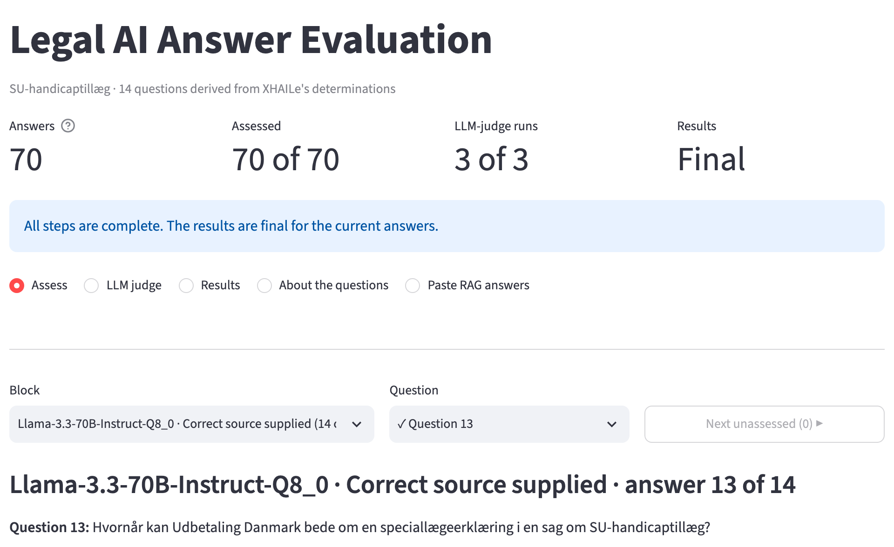

**An answer next to the correct source.** The Llama answer to question 13 with
correct source, next to the correct source and the expected answer.

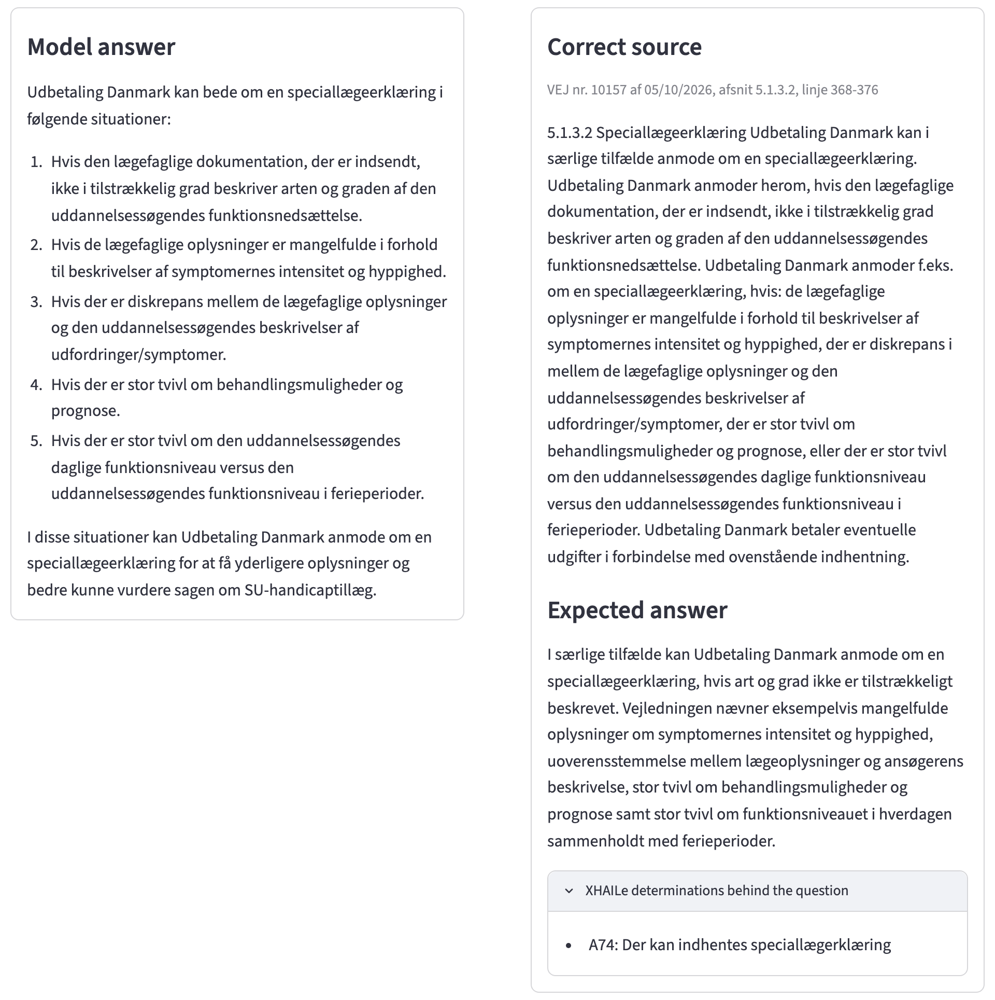

**The ten criteria for the same answer.** C1 to C3, then C4 to C6, where the
answer cites no source, and C7 to C10, where C8 is Not met because the words
"i særlige tilfælde" were removed.

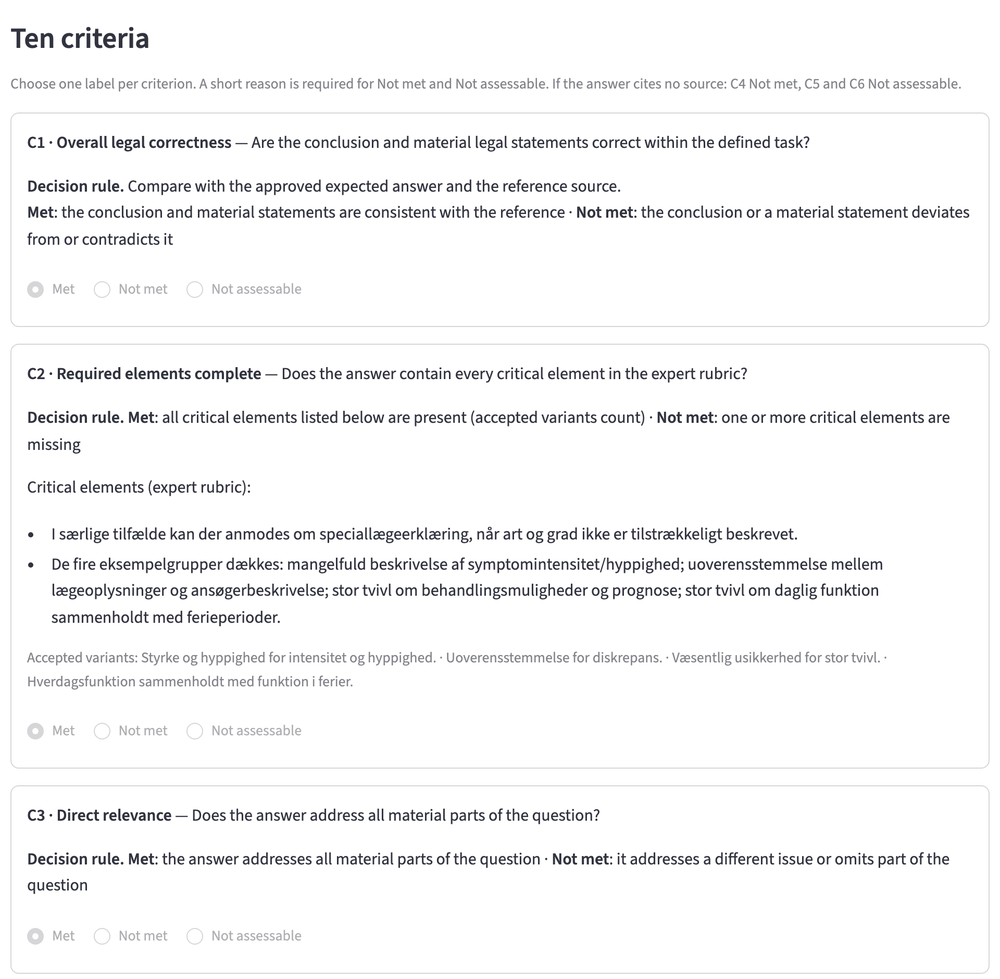
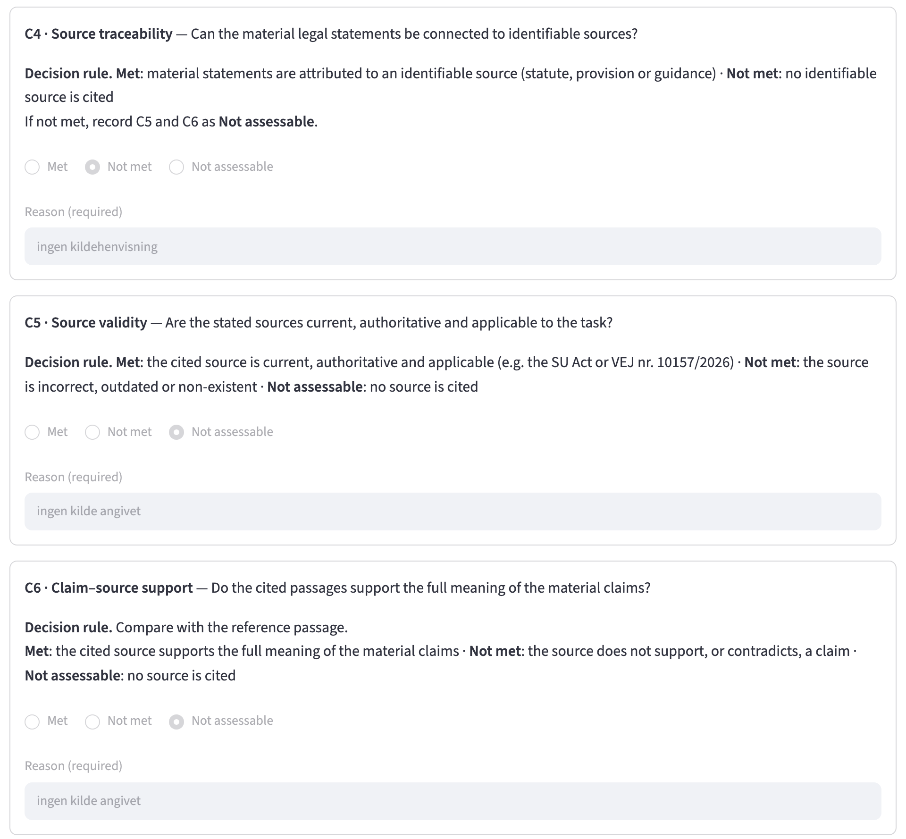
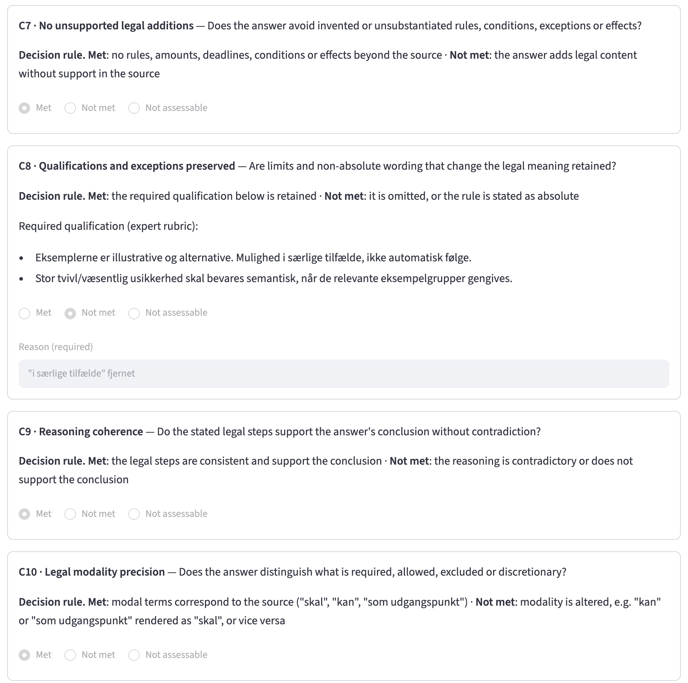

**About the questions.** Where the questions come from, and question 13 with
the XHAILe determination behind it.

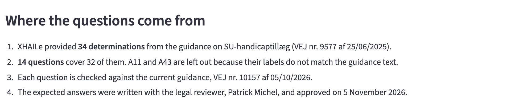
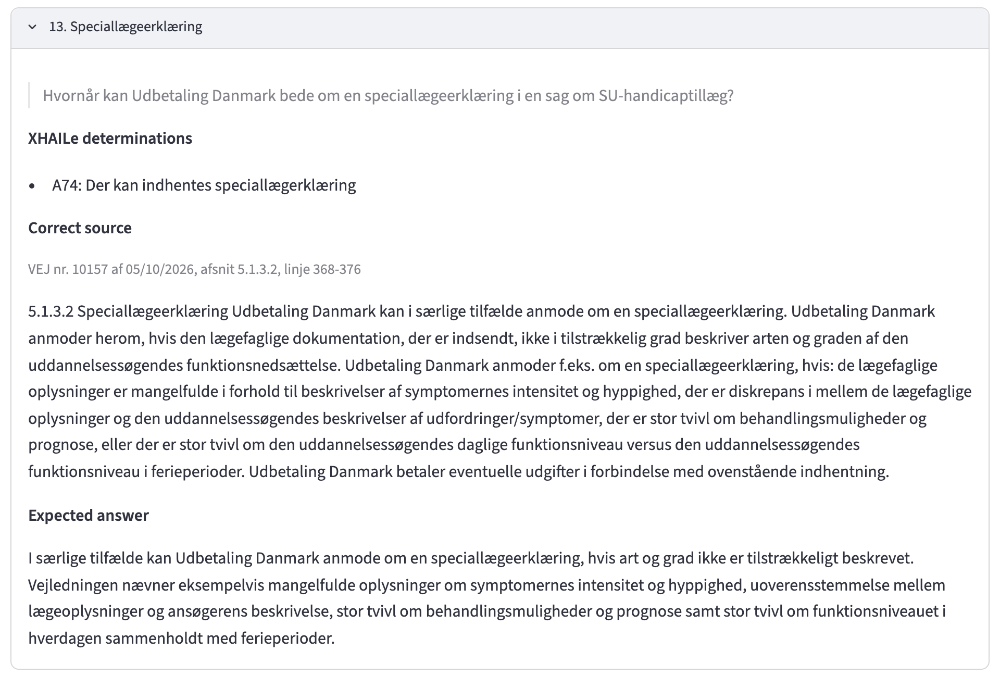

**The answer table for one block.** Llama with correct source, one row per
answer and one column per criterion.

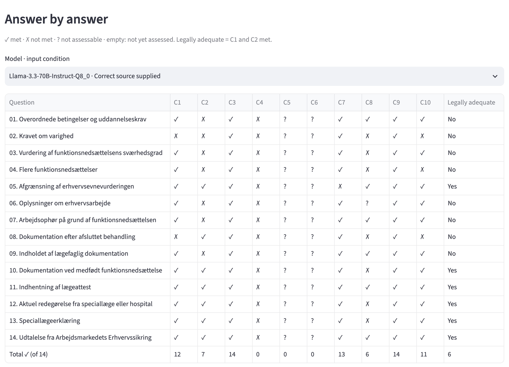

**The LLM judge.** The three runs, and the agreement with the legal reviewer.

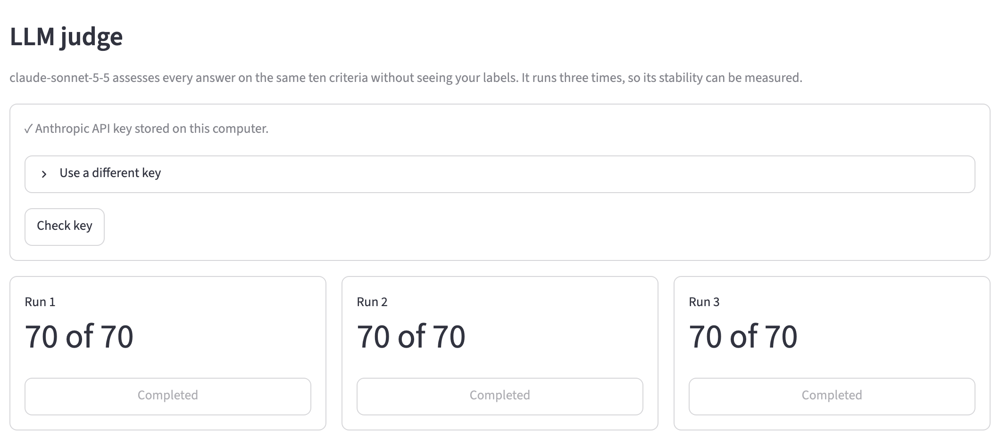
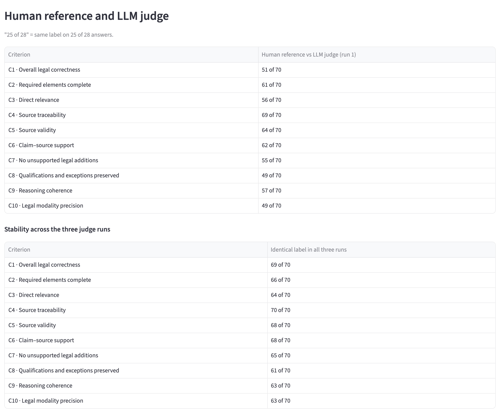

**The Llama model on UCloud.** Llama 3.3 70B Instruct ran as an interactive
job on DeiC Interactive HPC (SDU) on one NVIDIA B200 GPU.

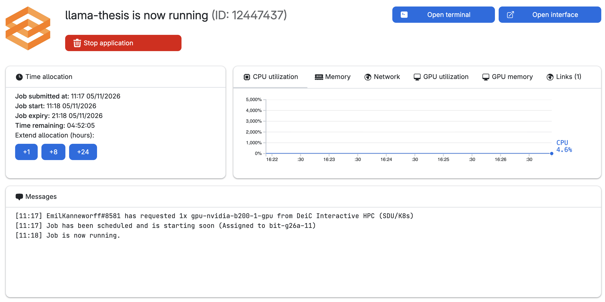
